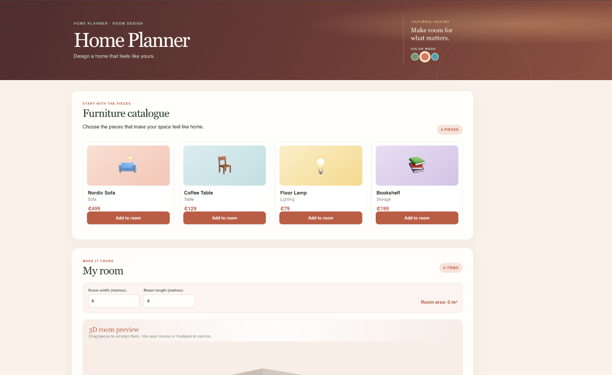

# Home Planner

A full-stack room planning application for browsing furniture, arranging items in an interactive 3D room, changing the visual theme, and saving or loading room designs.

Home Planner combines a React interface, an Express REST API, and PostgreSQL. It is designed as a personal project for practicing full-stack development, 3D visualisation, API integration, database persistence, testing, and Docker.

## Features

- Browse a catalogue of sofas, tables, lamps, and bookshelves.
- Add furniture to the room or remove it from the selection.
- View furniture in an interactive Three.js 3D room.
- Drag the sofa, coffee table, floor lamp, and bookshelf to reposition them.
- Rotate the sofa by pressing `R` while the application is open.
- Enter room width and length values and calculate the room area.
- Switch between Sage, Terracotta, and Ocean colour themes.
- Save room selections and furniture positions through a REST API.
- Load the most recently saved room design from PostgreSQL.

## Screenshots

### Furniture Catalogue and Colour Themes



### 3D Room and Furniture Arrangement


### Selected Furniture and Total


## Technology Stack

| Layer | Technologies |
| --- | --- |
| Frontend | React 19, TypeScript, Vite |
| 3D visualisation | Three.js, React Three Fiber, Drei |
| Backend | Node.js, Express 5, TypeScript |
| Database | PostgreSQL 15, JSONB |
| Database container | Docker and Docker volumes |
| Testing | Vitest, Supertest |
| Package management | npm |

## Architecture

### Frontend

The frontend is in `client/`. React manages the catalogue, selected furniture, room dimensions, positions, rotation, and colour theme. React Three Fiber renders the 3D room and furniture.

The browser communicates with the API over HTTP:

- `GET /api/furniture`
- `POST /api/design`
- `GET /api/design`

### Backend

The backend is in `client/server/`. Express validates room-design requests, serves the furniture catalogue, and uses `pg` to communicate with PostgreSQL.

Before listening on port `5000`, the backend creates the `room_designs` table if needed and checks the database connection.

### Database

PostgreSQL stores the latest and historical room-design payloads as JSONB. Each design contains the selected furniture, furniture positions, and sofa rotation.

```text
React frontend
      |
      | HTTP/JSON
      v
Express REST API
      |
      | pg connection pool
      v
PostgreSQL
      |
      v
Docker volume
```

## API

| Method | Endpoint | Description |
| --- | --- | --- |
| `GET` | `/api/furniture` | Returns the furniture catalogue. |
| `POST` | `/api/design` | Validates and saves a room design. |
| `GET` | `/api/design` | Returns the most recently saved design, or `404` when none exists. |

The API runs at `http://localhost:5000`.

## Room-Design Data

The API expects a JSON body with the following shape:

```json
{
  "furniture": [],
  "sofaPosition": [0, 0, 0],
  "coffeeTablePosition": [0, 0, 2],
  "floorLampPosition": [3, 0, 2],
  "bookshelfPosition": [-3, 0, -2],
  "sofaRotation": 0
}
```

- `furniture` is an array of selected furniture objects.
- Position values are `[x, y, z]` coordinates.
- `sofaRotation` is measured in radians.
- A furniture object's `id`, `name`, `category`, `price`, and `emoji` fields are documented in the data model and should be preserved when it is returned by the API.

See [POSTGRESQL.md](./server/POSTGRESQL.md) for database setup and environment-variable details.

## Getting Started

### Prerequisites

- Node.js and npm
- Docker Desktop
- Git

### 1. Clone the Repository

```sh
git clone <YOUR_GITHUB_REPOSITORY_URL>
cd <YOUR_PROJECT_DIRECTORY>
```

Replace both placeholders with your repository URL and local project directory name.

### 2. Start PostgreSQL

PostgreSQL can run in Docker on host port `5433`:

```sh
docker run -d \
  --name home-planner-postgres \
  -e POSTGRES_USER=homeplanner \
  -e POSTGRES_PASSWORD=YOUR_LOCAL_PASSWORD \
  -e POSTGRES_DB=home_planner \
  -p 5433:5432 \
  -v home_planner_data:/var/lib/postgresql/data \
  --restart unless-stopped \
  postgres:15
```

Check the container:

```sh
docker ps
docker logs home-planner-postgres
```

### 3. Configure the Backend

Create `client/server/.env`:

```env
DB_HOST=localhost
DB_PORT=5433
DB_USER=homeplanner
DB_PASSWORD=YOUR_LOCAL_PASSWORD
DB_NAME=home_planner
```

Use the password configured for the Docker PostgreSQL role. Never commit `.env` or database passwords. The file is intended to remain ignored by Git.

### 4. Install Dependencies

```sh
cd client
npm install

cd server
npm install
```

The commands above assume `client` is the current project directory. If you are already inside `client`, run `cd server` directly.

### 5. Start the Backend

From `client/server`:

```sh
npm run dev
```

Wait until the terminal reports a successful PostgreSQL connection.

### 6. Start the Frontend

Open a second terminal in `client`:

```sh
npx vite --host 127.0.0.1
```

Open the local URL printed by Vite, normally `http://127.0.0.1:5173`.

Docker, PostgreSQL, and the backend must be running for the catalogue and save/load features to work.

## Testing

Run the backend API tests from `client/server`:

```sh
npm run test:run
```

The tests cover:

- Furniture catalogue retrieval.
- Saving a room design.
- Loading the latest design.
- Re-saving and loading an updated furniture selection.
- Malformed design validation.

The tests use the configured PostgreSQL database and remove rows they create. Run them only against a local or dedicated test database, not production.

## Project Structure

```text
Home-Planner/
└── client/
    ├── public/
    ├── src/
    │   ├── App.tsx
    │   ├── App.css
    │   ├── Room3D.tsx
    │   ├── index.css
    │   └── main.tsx
    ├── index.html
    ├── package.json
    ├── vite.config.ts
    └── server/
        ├── POSTGRESQL.md
        ├── package.json
        └── src/
            ├── app.ts
            ├── app.test.ts
            ├── db.ts
            └── data/
                └── furniture.ts
```

## Future Improvements

- Add accurate room dimensions, custom room layouts, doors, windows, and floor and wall finishes.
- Improve furniture placement with grid snapping, collision detection, resizing, rotation, and undo/redo.
- Add a 2D floor plan, realistic furniture models, better camera controls, and room previews.
- Expand the catalogue with search, filters, categories, variants, dimensions, and availability.
- Support multiple designs, user accounts, design sharing, shopping lists, and exports.
- Improve mobile and tablet controls and add frontend, end-to-end, and visual tests.

## Security and Configuration

- Do not commit `.env`, credentials, database passwords, or private database URLs.
- Use a local or dedicated test database for automated tests.
- Replace example or placeholder passwords with credentials generated for your own environment.
