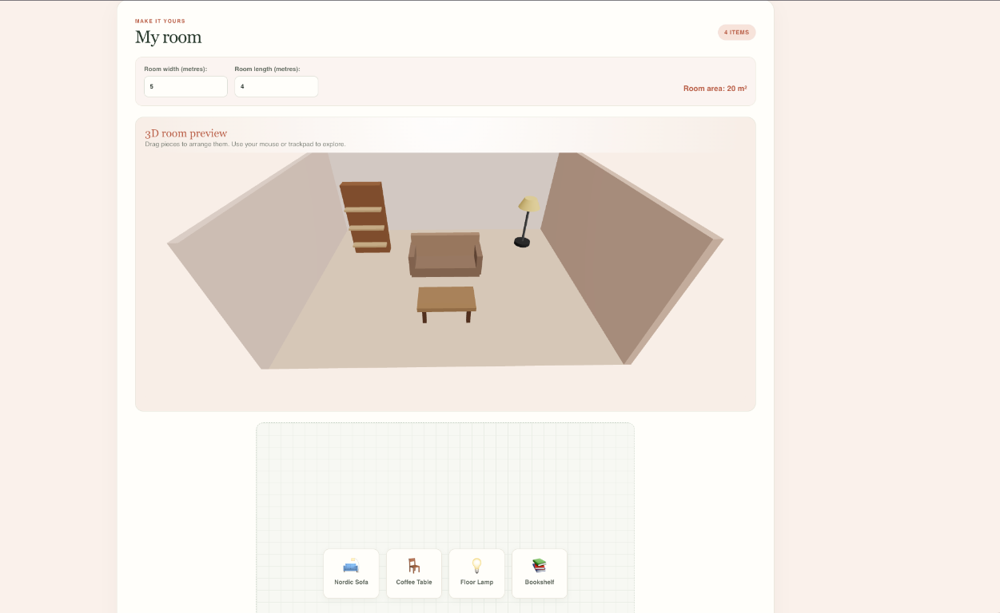
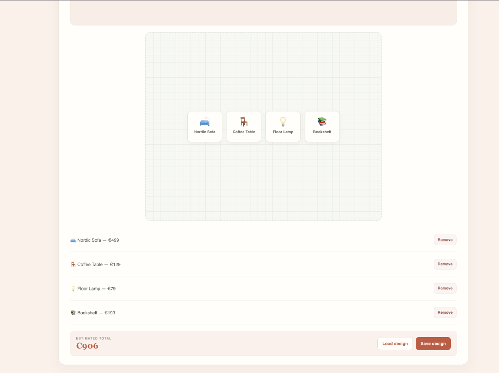

# Home Planner

Home Planner is a room-planning project that lets me browse furniture, arrange pieces in a 3D room, and save or reload a design.

I built it to practice the parts of a full application that need to work together: React for the interface, Three.js for the room preview, Express for the API, and PostgreSQL for storing designs. Docker keeps the local database setup consistent and makes it easy to start over.

## Features

- Browse furniture for the room, including a sofa, coffee table, floor lamp, and bookshelf.
- Add and remove furniture from the selected room.
- Move furniture around the 3D floor by dragging it.
- Rotate the sofa by pressing `R`.
- Enter room width and length values and calculate the room area.
- Switch between Sage, Terracotta, and Ocean themes.
- Save the furniture selection and furniture positions to PostgreSQL.
- Load the most recently saved design.

## Screenshots

### Furniture catalogue and colour themes


### 3D room and furniture arrangement



### Selected furniture and estimated total



## Technology

| Area | Tools |
| --- | --- |
| Frontend | React 19, TypeScript, Vite |
| 3D rendering | Three.js, React Three Fiber, Drei |
| Backend | Node.js, Express 5, TypeScript |
| Database | PostgreSQL 15 with JSONB |
| Local database | Docker and Docker volumes |
| Tests | Vitest and Supertest |
| Package manager | npm |

## How the application fits together

### Frontend

The React frontend is under `client/`. It contains the furniture catalogue, room dimensions, selected-furniture list, colour theme controls, save/load actions, and the 3D scene.

The browser calls the backend through:

- `GET /api/furniture`
- `POST /api/design`
- `GET /api/design`

### Backend

The Express API is under `client/server/`. It validates incoming design data, serves the furniture catalogue, and communicates with PostgreSQL through the `pg` package.

When the server starts, it checks PostgreSQL and creates the `room_designs` table if it does not exist. It then listens on port `5000`.

### Database

PostgreSQL stores room-design JSON in a `room_designs` table. A design includes the selected furniture, sofa and furniture positions, and the sofa's rotation.

```text
React frontend
      |
      | HTTP/JSON
      v
Express REST API
      |
      | PostgreSQL connection pool
      v
PostgreSQL in Docker
      |
      v
Persistent Docker volume
```

## API

| Method | Route | What it does |
| --- | --- | --- |
| `GET` | `/api/furniture` | Returns the four-item furniture catalogue. |
| `POST` | `/api/design` | Checks and saves a room design. |
| `GET` | `/api/design` | Returns the latest saved design, or `404` if no design exists. |

The API is available at `http://localhost:5000`.

## Saved design format

The save request uses this JSON structure:

```json
{
  "furniture": [],
  "sofaPosition": [0, 0, 0],
  "coffeeTablePosition": [0, 0, 2],
  "floorLampPosition": [3, 0, 2],
  "bookshelfPosition": [-3, 0, -2],
  "sofaRotation": 0
}
```

- `furniture` contains the selected catalogue items.
- Each position is an `[x, y, z]` coordinate.
- `sofaRotation` is stored in radians.
- Furniture objects include `id`, `name`, `category`, `price`, and `emoji`.

The database configuration and table behaviour are covered in [POSTGRESQL.md](./server/POSTGRESQL.md).

## Running locally

### What you need

- Git
- Node.js and npm
- Docker Desktop
- A PostgreSQL container or another PostgreSQL database

### 1. Clone the project

```sh
git clone https://github.com/Sowjanyakambhampati/home-planner.git
cd home-planner
```

### 2. Start PostgreSQL

The project uses host port `5433` for a Docker container running PostgreSQL on port `5432`:

```sh
docker run -d \
  --name home-planner-postgres \
  -e POSTGRES_USER=homeplanner \
  -e POSTGRES_PASSWORD=YOUR_LOCAL_PASSWORD \
  -e POSTGRES_DB=home_planner \
  -p 5433:5432 \
  -v home_planner_data:/var/lib/postgresql/data \
  --restart unless-stopped \
  postgres:15
```

You can check the container with:

```sh
docker ps
docker logs home-planner-postgres
```

### 3. Configure the backend

Create `client/server/.env` with local database settings:

```env
DB_HOST=localhost
DB_PORT=5433
DB_USER=homeplanner
DB_PASSWORD=YOUR_LOCAL_PASSWORD
DB_NAME=home_planner
```

Use the password you set in the Docker command. Keep `.env` private and never commit it or a real database password.

### 4. Install dependencies

Install the frontend packages:

```sh
cd client
npm install
```

Install the backend packages in another terminal:

```sh
cd client/server
npm install
```

### 5. Start the backend

From `client/server`:

```sh
npm run dev
```

The terminal should confirm that PostgreSQL connected before the API begins listening.

### 6. Start the frontend

In another terminal, from `client`:

```sh
npm run dev
```

Open `http://127.0.0.1:5173`. Both Docker/PostgreSQL and the backend API need to be running for the catalogue and save/load actions to work.

## Tests

Run the API tests from `client/server`:

```sh
npm run test:run
```

The tests cover:

- Furniture catalogue retrieval
- Saving a room design
- Loading the latest design
- Saving and loading an updated furniture selection
- Rejecting malformed design or furniture data

Test-created room designs are deleted after the test run. Use a local or dedicated test database rather than a production database.

## Project structure

```text
home-planner/
└── client/
    ├── docs/screenshots/
    ├── public/
    ├── src/
    │   ├── App.tsx
    │   ├── App.css
    │   ├── Room3D.tsx
    │   ├── index.css
    │   └── main.tsx
    ├── index.html
    ├── package.json
    ├── vite.config.ts
    └── server/
        ├── POSTGRESQL.md
        ├── package.json
        └── src/
            ├── app.ts
            ├── app.test.ts
            ├── db.ts
            └── data/
                └── furniture.ts
```

## Future improvements

- Accurate room dimensions, custom layouts, doors, windows, and wall or floor finishes.
- Grid snapping, collision detection, furniture resizing and rotation, and undo/redo controls.
- A 2D floor plan, realistic furniture models, better camera controls, and room previews.
- Catalogue search, filters, categories, variants, dimensions, and availability.
- Multiple saved designs, user accounts, design sharing, shopping lists, and exports.
- Better mobile/tablet controls and frontend, end-to-end, and visual tests.

## Security

- Do not commit `.env`, database passwords, credentials, or private database URLs.
- Use a local or dedicated database for tests.
- Replace example passwords with credentials created for your own environment.
